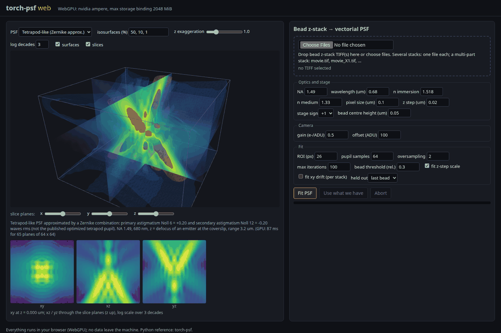
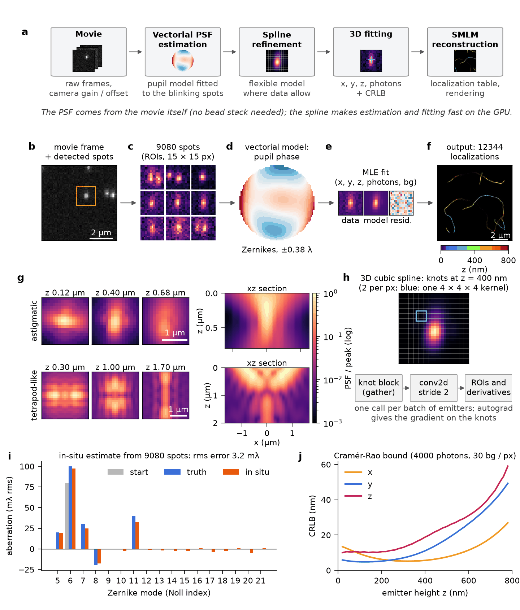

# torch-psf

**Web viewer:** [jcnossen.github.io/torch-psf](https://jcnossen.github.io/torch-psf/) runs the PSF fit in the browser (WebGPU), without installation.

<a href="https://jcnossen.github.io/torch-psf/"></a>

A PSF library for single-molecule localization microscopy (SMLM), in plain PyTorch, batched on the GPU. The PSF is
the main object: every model renders the PSF with its x / y / z derivatives, and the base class `PSF` gives each of
them the Cramér-Rao bound, maximum-likelihood fitting of spots, localization of whole movies, files and conversion to
a cubic spline.

- **models**: `VectorialPSF` (vectorial pupil function with Zernike aberrations), `CubicSplinePSF` (a 3D cubic
  spline evaluated with one strided, grouped `conv2d` per batch of spots), `GaussianPSF` (2D),
  `AstigmaticGaussianPSF` (3D calibration curves) and `FourPiPSF` / `FourPiSplinePSF` (two-objective interference).
  Vectorial, 4Pi and field-dependent models support exact spectral pixel integration and integrated cubic B-splines.
- **fitting**: Poisson maximum likelihood (Levenberg-Marquardt, optional sCMOS read noise) and the Cramer-Rao bound;
- **pipeline**: spot detection on movies, ROI extraction, and the localizations as a `Dataset` (filters, drift, rendering,
  FRC, HDF5 / Picasso / ThunderSTORM files);
- **PSF estimation**: from bead z-stacks and *in situ* from the blinking emitters themselves. The in-situ fit evaluates
  every emitter on the spline and passes the likelihood gradient from the spline knots to the pupil parameters with one
  vector-Jacobian product, so its cost does not grow with the number of emitters.



*Overview (made by [examples/make_overview_figure.py](examples/make_overview_figure.py) from generated data).
(a) The workflow. (b-f) The flow in detail: a movie frame with detected spots, spot ROIs, the vectorial model (pupil
aberration phase), a maximum-likelihood fit (data, model, normalized residual), the localizations as a
super-resolution image coloured by z. (g) Sections of an astigmatic and a tetrapod-like PSF, (h) the 3D cubic spline,
(i) the in-situ Zernike estimate against the truth, (j) the Cramér-Rao bound.*

```python
import torch, torch_psf as tp

camera = tp.Camera(gain_e_per_adu=0.5, offset_adu=100.0, readnoise_e=1.5)   # or measured from the movie:
# camera, _ = tp.photon_transfer('movie.tif', excess_noise=2.0)               # (EMCCD: excess noise factor F^2 = 2)
psf = tp.InSituEstimator(start=tp.PSF.load('beads.json'), camera=camera).estimate('movie.tif')   # PSF from the data
spline = psf.to_spline(roisize=13, z_range=(0.0, 0.8))                         # fast form of the same PSF
locs = spline.localize('movie.tif', camera, frames=(0, 1000))                   # Dataset: pos, crlb, photons, bg, ...
print(locs, locs.crlb[:, 0].mean())
locs.save('locs.hdf5')                                                           # or .csv (ThunderSTORM), save_picasso

pos = torch.tensor([[0.2, -0.1, 0.3]], device=spline.dev)                       # x, y (px from the ROI centre), z (um)
img, dx, dy, dz = spline.render(pos, grad=True)                                  # [1, 13, 13] each
psf.save('insitu.json')
```

## Install

```bash
git clone https://github.com/jcnossen/torch-psf.git && cd torch-psf
pip install -e .                  # numpy, scipy, torch, tifffile, h5py, matplotlib; [test] adds pytest, [viewer] scikit-image
```

A GPU is optional: every function takes `device=` and defaults to `cuda` when available, else `cpu`.

## Conventions

- x = column, y = row, in px, pixel centres at integers. Positions inside a ROI are offsets from the ROI centre.
- z = emitter height above the coverslip (um); `focus_um` = focal plane relative to the coverslip (um).
- Lengths carry their unit in the name (`pixel_um`, `wavelength_um`, `dz_um`, `focus_um`); intensities and background
  in photons (photons / px for the background); aberrations in waves rms (Noll-indexed Zernikes).
- `PSF` (base class): `render(pos [N, 3], grad=False)` -> `[N, P, P]` (or `(psf, d/dx, d/dy, d/dz)`), `expected`,
  `fisher`, `crlb`, `fit(rois)` and `localize(movie)` (-> `Dataset`), `save` / `PSF.load`, `to_spline`;
  `roisize`, `z_range` (None for 2D), `n_dims`, `xy_limit`. A new model only implements `render`.
- Estimators (`ZStackEstimator`, `InSituEstimator`) return the PSF; their numbers are in `estimator.report` (dict) and
  `estimator.history`. The class diagram and the change notes are in [docs/API.md](docs/API.md).

## Entry points

Each has a Python form and a command (`python -m torch_psf <command> -h`). The worked examples run on generated
data in seconds on a GPU.

**Bead z-stacks -> PSF** ([examples/bead_fit.py](examples/bead_fit.py); `--epfl` runs it on a one-bead crop of the
public EPFL SMLM challenge 2016 bead stack in `tests/data/web/`). `model='vectorial'` fits Zernikes, `'spline'` fits
cubic-spline knots regularised towards that vectorial fit, `'astig_gauss'` the astigmatic Gaussian curves.

```python
est = tp.ZStackEstimator('vectorial', optics=tp.Optics(pixel_um=0.108, NA=1.49),
                         camera=tp.Camera(gain_e_per_adu=0.5, offset_adu=100), roisize=21, holdout=1)
psf = est.estimate(['stack1.tif', 'stack2.tif'], dz_um=0.025)
print(est.report['heldout_nll_per_px'], psf.zcoef)
psf.save('beads.json')
```
```bash
python -m torch_psf beads stack1.tif stack2.tif --dz-um 0.025 --pixel-um 0.108 --na 1.49 --gain 0.5 --offset 100 -o beads.json
```

**SMLM movie -> in-situ PSF** ([examples/insitu_fit.py](examples/insitu_fit.py)): starts from a bead calibration or a
nominal model and fits the Zernikes (or a free pupil, `method='pupil'`) to spots of the movie. Spots the
single-emitter model does not explain (overlapping emitters) are rejected after a first pass. `refine=True` adds a
cubic-spline refinement that is kept only if it improves the held-out likelihood. The report holds the held-out
comparison (checkerboard split by position), the fraction of fits at the offset limit and the z scale relative to
the starting PSF.

```python
est = tp.InSituEstimator(start='beads.json', focus_um=0.45, camera=camera, z_range=(0.0, 0.8), isolation=14)
psf = est.estimate('movie.tif')
print(est.report['heldout'], est.report['at_limit'], est.report['z_scale'])
```
```bash
python -m torch_psf insitu movie.tif --psf beads.json --focus-um 0.45 --isolation 14 -o insitu.json
```

**Localize a movie with a given PSF** ([examples/localize_movie.py](examples/localize_movie.py)): `psf.localize`
returns a `Dataset`: fields `pos` [n, 3] and `crlb` [n, 3] in px (z in px of the lateral pixel size), `frame`,
`photons`, `bg`, `chi2`, `loglik`, `at_limit`, ... with filters, drift correction, rendering, FRC and files
([docs/DATASET_FORMAT.md](docs/DATASET_FORMAT.md)); `psf.fit(rois)` does the same for ROIs you cut yourself.

```python
locs = tp.PSF.load('insitu.json').to_spline(13).localize('movie.tif', camera)
```
```bash
python -m torch_psf localize movie.tif --psf insitu.json --gain 0.5 --offset 100 -o locs.csv
```

**A spline directly from a measured z-stack** ([examples/zstack_spline.py](examples/zstack_spline.py)):
`tp.CubicSplinePSF.from_zstack(stack, z0_um, dz_um, roisize)` uses the stack planes as knots.

**Look at a PSF**: `python -m torch_psf view [psf.json]` starts a viewer on localhost (3D isosurfaces and slice planes,
pixel images, gradients, CRLB vs z; API in [docs/VIEWER_API.md](docs/VIEWER_API.md)). The page itself is built from
the `web/` project (`scripts/build_viewer.sh`).

**Lower level**: `tp.extract_spots(movie, roisize, camera)` (detection + ROIs), `torch_psf.fit` (`localize`,
`crlb`, `lm_poisson` for any model with an analytic Jacobian), `torch_psf.estimation` (`fit_beads`, `fit_zernike_knots`,
`fit_pupil_knots`, `fit_free_knots`, `fit_tracks` with variable projection, held-out checks, `z_scale`),
`torch_psf.simulate` (emitters, bead stacks, blinking movies, filament structures).

## Modules

| | |
|---|---|
| `vectorial.py` | `VectorialPSF`: dipole emission with Fresnel transmission and supercritical-angle fluorescence, refractive-index mismatch, Zernike aberrations (also per emitter), free pupil phase / amplitude maps, image-plane (line) blur, emission-dipole tensor (photoselection), diattenuation; chirp-z transform to an oversampled grid and pixel integration. |
| `psf.py` | `PSF`: the base class (statistics, fitting, localization, files, to_spline). |
| `spline.py` | `CubicSplinePSF`: Catmull-Rom (cubic) knots on a grid `oversample` times finer than the pixels; `render` (value and derivatives from one conv2d), knots from a vectorial model, the vector-Jacobian product back to its parameters, `from_zstack`. |
| `gaussian.py` | `GaussianPSF` (2D) and `AstigmaticGaussianPSF` (3D), pixel-integrated; `fit_gaussian_free_sigma`: spot fit with a free width (x, y, photons, bg, sigma; CRLB, chi2) for spot finding and width / chi2 filters. |
| `fourpi.py` | `FourPiPSF` renders coherent two-objective interference channels with midpoint or exact spectral pixel integration. `FourPiSplinePSF` preserves analytic phase dependence with cubic pixel-value tables or integrated density splines. |
| `zernike.py` | Zernike polynomials (Noll index and normalization). |
| `fit.py` | `lm_poisson`, `localize`, `fisher`, `crlb`, `poisson_nll`; `solve_linear` (variable projection: closed-form per-frame intensities and backgrounds of a track). |
| `detect.py`, `spots.py` | band-pass + local-maximum detection; `Spots` / `extract_spots` (streams over a movie), `Tracks`. |
| `estimators.py` | `ZStackEstimator`, `InSituEstimator`. |
| `estimation/` | the PSF estimation steps (`beads`: bead fit; `knots`: knot-route fits, free knots; `tracks`: variable projection on tracks; `heldout`: held-out checks; `zscale`). |
| `dataset.py` | `Dataset`: the localizations (dict of tensors; format in [docs/DATASET_FORMAT.md](docs/DATASET_FORMAT.md)). |
| `optics.py` | `Optics` (pixel size, NA, wavelength, refractive indices). |
| `simulate.py` | simulated data with known truth: isolated emitters, bead z-stacks, blinking SMLM movies, filaments. |
| `camera.py` | `Camera` (scalars or per-pixel maps; `excess_noise` for EMCCDs); `photon_transfer`: camera offset and gain from the background pixels of a movie; `white_photon_transfer`: the gain from the spatially white (beyond-OTF) part of the background noise of frame differences, robust to sample fluctuations, a patterned illumination and the offset fixed pattern; `maps_from_movie`: per-pixel sCMOS offset and read-noise maps from a sparse SMLM movie without dark frames (optionally the read noise of a reference recording at another sensor-ROI position). |
| `movie.py`, `io.py` | movie readers (TIFF incl. ImageJ > 4 GB and multi-part, memory-mapped), PSF files. |
| `psfzip.py`, `psfreport.py` | the psf.zip writer / reader (channels, mappings, field dependence, z-stack, preview) and its fit report. |
| `__main__.py`, `viewer.py` | the command line, the viewer server. |

**PSF file**: `psf.zip` (`torch_psf.io.save_zip(path, psf, camera=..., report=estimator)`; specification in
[docs/PSF_FORMAT.md](docs/PSF_FORMAT.md)): `psf.json` with the optics, camera, provenance and a `channels` list (each
channel a model of any type with its mapping to the reference channel and optional field dependence; 4Pi as one
coupled model), the arrays as `.npy`, `zstack.tif` (the model rendered through z), `preview.png` and `fit_report.pdf`
(an overview of the estimation); the web app writes and reads the same file. `PSF.load` also reads the earlier
single-JSON format (still written by `PSF.save`) and plain calibration json files;
`python -m torch_psf.psfzip calib.json` converts those to psf.zip.

## Tests

```bash
pip install -e .[test] && pytest tests
```

The tests check the vectorial model and the spline against the images of the pre-restructuring code (generated from
the git history on first use), the derivatives, that the fit reaches the Cramer-Rao bound (2D, sCMOS, astigmatic 3D),
detection recall, bead and in-situ recovery of known Zernike sets, PSF files, the API a downstream pipeline builds on,
the entry points and the viewer API. Tests that need a GPU to be fast are skipped on the CPU.

## Browser version

`web/` holds the browser app (TypeScript + WebGPU, [jcnossen.github.io/torch-psf](https://jcnossen.github.io/torch-psf/)):
in-situ PSF estimation and localization of SMLM movies, bead z-stack fits, a localization viewer and psf.zip export,
without installation; see [web/README.md](web/README.md).

## License

MIT, see [LICENSE](LICENSE).
