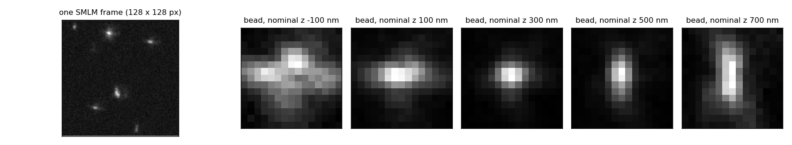
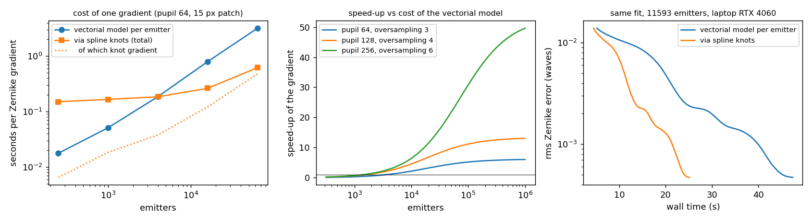
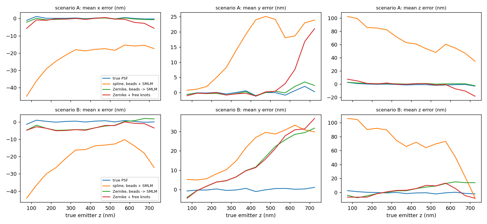

# In-situ PSF estimation through a spline: math, simulation, results

Status: first simulation study, 2026-11-13. One simulated data set per scenario, one seed, laptop GPU (RTX 4060).
Code: `torch_convspline/knotpsf.py`, `torch_convspline/vectorial.py`, `study/insitu/`.
Reproduce: `python study/insitu/run_study.py`, `bench_speed.py`, `bench_speed2.py`, `make_figs.py`
(`bench_speed*.py` read `out_dev_A.pt`, written by `check_fit.py A`).

## Summary

1. **Speed (the main claim).** The likelihood gradient with respect to the Zernike coefficients can be collected
   on the spline knots over all emitters and then passed once through the vectorial model. The gradient is the
   same as evaluating the vectorial model for every emitter (cosine similarity 1.00000), and the fit follows the
   same path. The cost per emitter drops from 45-390 µs to 7 µs. The gradient is 5x to 50x cheaper at 10^5-10^6
   emitters, depending on how finely the pupil is sampled. Below about 1,500-3,500 emitters there is no gain.
2. **Beads alone are not enough.** With beads on the coverslip and emitters up to 800 nm deep in water, both the
   Zernike fit and the spline fit of the bead stack give 50-80 nm z error and 12-40 % gross failures on the SMLM
   data. Refining the Zernikes on the SMLM data, starting from the bead fit, reaches the precision of the true PSF
   in 24 s when the pupil is a Zernike series (scenario A).
3. **Where a Zernike model falls short (scenario B).** With high-order phase and an amplitude defect in the
   pupil, the refined Zernike model leaves a likelihood deficit of 2.8 nats per emitter and a y error that grows
   to 30 nm across the z range. Free spline knots on top of the Zernike model remove the likelihood deficit
   (0.25 nats) but **not** the position error: a lateral shift of the PSF that depends on z cannot be seen in
   blinking data. This is a property of the data, not of the optimizer (section 2.4).
4. **A free pupil map (phase and amplitude pixels) through the same route** fits the images best (0.12 nats)
   but has the same problem in a milder form: a y shift proportional to z (up to 30-40 nm over 700 nm) that the
   data do not pin down. It appears even when the Zernike start was already correct.
5. **A spline shared between beads and SMLM data does not work** when the two PSFs differ. It fits the SMLM
   images well but keeps the z axis and lateral shifts of the bead stack (100 nm z offset here).

## 1. Simulation

Vectorial PSF: NA 1.49 oil objective (n 1.518), sample in water (n 1.33), 680 nm, 108 nm pixels, freely rotating
dipole, supercritical-angle light included, 0.10 waves astigmatism for 3D, small random Zernikes (Noll 5-21).

| | |
|---|---|
| Bead stack | 6 beads on the coverslip (emitter height 0), 26 focus planes, 40,000 photons per frame, background 30 |
| SMLM movie | 6000 frames of 128 x 128 px, 700 blinking sites at heights 0-800 nm, focus fixed, 4000 photons per frame (log-normal), background 30, about 4 emitters per frame |
| Detection | difference of Gaussians, isolated spots only; 11,600 patches of 15 x 15 px from 25,000 on-events |
| Test set | 6000 isolated emitters with known position, same conditions as the movie |
| Bead vs sample | the aberrations move between calibration and experiment (Noll 5, 7, 8, 11 by 0.02-0.04 waves) |
| Scenario A | pupil = Zernike series Noll 5-21 (the fitted model class contains the truth) |
| Scenario B | A + phase screen Noll 22-66 (0.06 waves rms) + a patch of the pupil with 60 % amplitude loss |

Simplifications: ideal camera (Poisson noise only), point-like beads, field-constant PSF, uniform background,
NA / refractive indices / wavelength known to the fit.

## 2. Math

### 2.1 Spline PSF

The pixel-integrated PSF is shift invariant: pixel $(i, j)$ of a patch with the emitter at offset $(x, y)$ from
the patch centre and height $z$ is $g(o_j - x,\, o_i - y,\, z)$, with $o$ the pixel offset from the centre.
$g$ is stored as knots $c_{k l m}$ on a grid with spacing $1/S$ px in $u, v$ and $h_z$ in $z$, and interpolated
with the Catmull-Rom cubic:

$$g(u, v, z) = \sum_{a,b,e=0}^{3} w_a(t_z)\, w_b(t_v)\, w_e(t_u)\; c_{k+a,\, l+b,\, m+e},\qquad
w(t) = (1, t, t^2, t^3)\, G$$

where $(k, l, m)$ and $t \in [0,1)^3$ are the integer and fractional knot coordinates, and $G$ is the 4 x 4
Catmull-Rom matrix. All pixels of a patch are $S$ knots apart and share $t$, so a $P \times P$ patch is one
4 x 4 x 4 kernel applied with stride $S$ (a grouped `conv2d` over the batch). Derivatives in $x, y, z$ use
$w'(t)$ in one of the three factors. With $S = 2$, $h_z$ = 40 nm the spline differs from the vectorial model by
0.2 % (relative L2), a likelihood cost of 0.002 nats for a 4000-photon emitter; $S = 1$ gives 1.8 %.

### 2.2 Likelihood

Patch $n$ with counts $d_{np}$ and emitter parameters $\theta_n = (x, y, z, I, b)_n$:

$$\mu_{np} = I_n\, g_p(\theta_n; c) + b_n, \qquad
L = \sum_{n,p} \mu_{np} - d_{np} \log \mu_{np}$$

$\mu$ is linear in the knots: $\mu_{np} = I_n \sum_k A_{np,k}(\theta_n)\, c_k + b_n$, with $A$ the (sparse, 64
entries per pixel) interpolation weights. So

$$\frac{\partial L}{\partial c_k} = \sum_{n,p} I_n\, A_{np,k} \left(1 - \frac{d_{np}}{\mu_{np}}\right)$$

which is the transpose of the patch evaluation applied to the residual images: one scatter-add per emitter.
For fixed $\theta$, $L$ is convex in $c$.

Bead frames enter the same likelihood with $z$ known (the stage position) and $x, y$ shared by all planes of a
bead.

### 2.3 Passing the gradient through the vectorial model

Let the knots be the vectorial model $V$ sampled on the knot grid, $c = B(\phi)$, with $\phi$ the Zernike
coefficients (or any other parameter: NA, refractive index, a free pupil map). Then

$$\frac{\partial L}{\partial \phi} = \left(\frac{\partial B}{\partial \phi}\right)^{\!\top} \frac{\partial L}{\partial c}$$

One iteration:

1. build the knots $c = B(\phi)$: $n_z S^2$ evaluations of $V$ (here 31 x 4 = 124 images of 23 x 23 px);
2. update $\theta_n$ on the spline (damped Newton per patch, 3 steps, warm start);
3. collect $\partial L / \partial c$ over all emitters (section 2.2);
4. one backward pass through the build gives $\partial L / \partial \phi$; Adam step on $\phi$.

Cost per iteration: $N\, t_\text{spline} + t_\text{build+VJP}$, against $N\, t_V$ when $V$ is evaluated per
emitter. The result is exact up to the interpolation error of the spline. Nothing in steps 1 and 4 depends on
the number of emitters.

### 2.4 What blinking data cannot determine

Each emitter is seen at one unknown $z$. The likelihood is therefore unchanged under

* a lateral shift per plane: $g(u, v, z) \to g(u - \delta_x(z), v - \delta_y(z), z)$ with $x_n \to x_n + \delta_x(z_n)$;
* a relabelling of the z axis: $z \to f(z)$ for any monotone $f$;
* a brightness change per plane: $g \to a(z)\, g$ with $I_n \to I_n / a(z_n)$.

A free-knot spline has all three freedoms. A Zernike model has none of them as free functions: the pupil
physics ties the lateral shift, the z scale and the brightness to the shape. If the model class contains the
truth this is what makes the in-situ fit work; if it does not (scenario B), the shape error leaks into exactly
these three quantities. A bead stack fixes all three (known stage z, the same bead at every plane), but for the
bead PSF, which is not the sample PSF.

## 3. Results

### 3.1 Speed

Left: seconds per Zernike gradient against the number of emitters. Middle: speed-up of the gradient for three
settings of the vectorial model. Right: the same fit (same data, optimizer and start) with both routes.

| vectorial model (pupil grid, oversampling) | per emitter, vectorial | per emitter, spline | fixed cost per iteration | break-even | speed-up at 10^4 / 10^5 / 10^6 emitters |
|---|---|---|---|---|---|
| 64, 3 | 45 µs | 7.4 µs | 0.14 s | 3,500 | 2.2 / 5.2 / 6.1 |
| 128, 4 | 98 µs | 7.4 µs | 0.14 s | 1,600 | 4.6 / 11 / 13 |
| 256, 6 | 386 µs | 7.2 µs | 0.53 s | 1,400 | 6.4 / 31 / 50 |

* Both routes give the same gradient (cosine similarity 1.00000 at every N) and the same final Zernike error
  (0.00047 waves rms).
* Whole fit, 11,593 emitters, 60 iterations, cheapest vectorial setting: 25 s through the knots, 47 s with the
  vectorial model per emitter. In both, the emitter updates already run on the spline; a fit that also
  localizes with the vectorial model is slower still (not measured).
* The spline cost is the plain autograd gather / scatter of this repo. The CuPy kernels in smlmgrad are faster;
  not used here.
* The 10^6 column is extrapolated from the per-emitter costs (linear in N); measured up to 64,000.

### 3.2 Accuracy

Scored on the 6000 test emitters. "Likelihood deficit": mean extra negative log-likelihood per emitter compared
with fitting the true PSF (0 = indistinguishable from the truth). "Failures": z error above 150 nm or xy error
above half a pixel. RMS errors exclude failures. Time includes the steps it builds on.

**Scenario A (pupil is a Zernike series)**

| PSF estimate | likelihood deficit | failures | x rms (nm) | y rms | z rms | time |
|---|---|---|---|---|---|---|
| true PSF | 0 | 1.5 % | 9.6 | 13.3 | 21.5 | |
| Zernike, beads only | 15.7 | 33 % | 18.6 | 23.1 | 61 | 7 s |
| spline, beads only | 17.2 | 12 % | 25.0 | 20.8 | 76 | 3 s |
| spline shared by beads + SMLM | 0.26 | 11 % | 24.6 | 21.8 | 74 | 19 s |
| Zernike, beads then SMLM (through the knots) | 0.01 | 1.5 % | 9.7 | 13.3 | 21.5 | 24 s |
| the same + free knots | 0.19 | 4.0 % | 10.3 | 15.3 | 25.3 | 35 s |

**Scenario B (pupil has structure outside the Zernike series)**

| PSF estimate | likelihood deficit | failures | x rms (nm) | y rms | z rms | time |
|---|---|---|---|---|---|---|
| true PSF | 0 | 1.1 % | 10.2 | 13.8 | 22.1 | |
| Zernike, beads only | 17.1 | 42 % | 21.9 | 21.7 | 51 | 4 s |
| spline, beads only | 17.9 | 16 % | 24.4 | 22.4 | 81 | 3 s |
| spline shared by beads + SMLM | 0.40 | 19 % | 24.5 | 24.6 | 81 | 17 s |
| Zernike, beads then SMLM (through the knots) | 2.80 | 7.4 % | 10.7 | 20.7 | 24.3 | 23 s |
| the same + free knots | 0.25 | 14 % | 10.5 | 19.6 | 25.7 | 35 s |

Mean error against true emitter height.

* Scenario A: the refined Zernike model is as good as the truth. Free knots on top only add noise (y and z
  drift at the top of the z range, where few photons constrain the knots).
* Scenario B: the Zernike model has a y error that rises from -4 to +32 nm over the z range and a z error from
  -8 to +15 nm. Free knots fit the images (deficit 2.8 -> 0.25) and leave both curves where they were, as
  section 2.4 predicts. The failure rate goes up (7 % -> 14 %); cause not investigated.
* The shared spline keeps the bead geometry: 100 nm z offset, z scale 0.9, x shift up to 45 nm.

### 3.3 Free pupil map through the knot route

`study/insitu/run_pupil.py`, `diag_pupil.py`. Parameters: the 17 Zernikes plus a pixel map of pupil phase and of
log amplitude on the 64 x 64 pupil grid (about 3,200 pixels each inside the aperture). Start: the Zernike in-situ
fit. 200 Adam iterations through the knot route, 0.35 s per iteration with 11,000 emitters. Piston, tilt and
defocus are projected out of the phase map.

| | likelihood deficit | z rms (nm) | mean y error over the z range (nm) | mean z error over the z range (nm) |
|---|---|---|---|---|
| A, Zernike | 0.01 | 21.5 | -1 .. +4 | -2 .. +3 |
| A, free phase + amplitude | 0.06 | 21.2 | -2 .. +29 | -5 .. +3 |
| A, free phase only | 0.04 | 21.7 | -2 .. +23 | +2 .. +6 |
| B, Zernike | 2.80 | 24.3 | -4 .. +32 | -8 .. +15 |
| B, free phase + amplitude | 0.12 | 21.6 | -6 .. +41 | -4 .. +11 |
| B, free phase only | 0.15 | 22.6 | -3 .. +39 | +2 .. +14 |
| B, free knots (3.2) | 0.25 | 25.7 | -5 .. +37 | -8 .. +13 |

* The free pupil gives the best image fit in scenario B (deficit 0.12) and z precision equal to the true PSF.
* It does **not** remove the y error that grows with z. In scenario A, where the Zernike start is already
  correct, freeing the pupil creates such an error (up to 29 nm; 23 nm with the amplitude held fixed).
* The recovered pupil in B is not the true one: phase differs by 0.06 waves rms (as large as the high-order
  screen itself), log-amplitude correlation with the truth is 0.21. A different pupil explains the images
  equally well.
* 700 iterations instead of 200 change nothing. A roughness penalty on the maps strong enough to matter brings
  back the Zernike result (deficit 1.9-2.5) with the same y error.
* For the pupil fits the "failures" of the criterion in 3.2 (5-16 %) are almost all y errors above half a pixel
  at the top of the z range, i.e. this tilt, not wrong z branches (wrong z: 0.1 %).

So a lateral shift proportional to z ("tilt of the z axis") is weakly determined by blinking data even with a
pupil model, once the pupil is free: odd phase terms in the pupil trade against a z-dependent emitter shift. The
17-term Zernike series is rigid enough to exclude it when it contains the truth. Only y is affected here,
probably because of the astigmatism orientation; not investigated.

## 4. When would a Zernike vectorial model not suffice?

From the simulation: a free-form in-situ PSF pays off in the image fit, but the position accuracy stays limited
by the three freedoms of section 2.4, and the free pupil of section 3.3 by the first of them. A free-form model needs something extra to fix them: a second detection
plane (biplane), a physical model for the low-order part plus a penalty that keeps the free part from carrying a
lateral shift, or a known structure in the sample.

Effects reported in the literature as outside a Zernike pupil model (sources in
[insitu_psf_literature.md](insitu_psf_literature.md)): discontinuous phase masks such as Tetrapod or double
helix (uiPSF reports its Zernike model as blurry there), light that misses the mask, pupil amplitude errors and
higher-order aberrations (named by Droste et al. as their residual mismatch), residual blur (uiPSF adds a
Gaussian blur term), fixed dipoles, bead size, 4Pi and light-sheet geometries.

Route 2.3 is not limited to Zernikes: $\phi$ can be a free pixel map of the pupil. Section 3.3 tests this. It
fits the images best of all, but it does not fix the positions either.

## 5. Relation to other in-situ methods

Full table with sources: [insitu_psf_literature.md](insitu_psf_literature.md) (web survey, 2026-11-13; some
papers could only be read as preprints).

* INSPR / VISPR: sort spots into z classes, average, phase-retrieve on the averages. The pupil model is
  evaluated on averages only, which is a coarse version of the idea in 2.3 without a per-emitter likelihood.
* uiPSF: autodiff + L-BFGS over the PSF and all emitter parameters, a few thousand emitters, 5-50 min on an
  RTX 3080. Its voxel PSF is for beads only; in situ it offers Zernike or pixel pupil.
* Droste et al. 2025 (Optica): vectorial fit with field-dependent Zernikes, 1,000-5,000 emitters, 30-45 s on a
  12-core CPU.
* The survey found no method that collects the gradient on an interpolation table and back-propagates once, and
  no spline or voxel PSF learned from blinking data.

For a field-constant Zernike PSF a few thousand emitters are enough, and at that size the knot route has no
advantage (break-even 1,500-3,500). The speed claim needs a setting that needs many emitters: field-dependent
aberrations, a free pupil map, per-tile or time-resolved PSFs. None of these is tested here.

## 6. Not done

* One seed per scenario; no error bars on any number above.
* No comparison against uiPSF or Vectorfit on the same data.
* Field dependence, biplane, or a tie between the tilt of the z axis and the bead stack: not tested.
* Why the free pupil tilts only in y, and whether more emitters or a wider z range remove it: not investigated.
* The regularization weights of the free-knot fits were chosen by looking at the test-set likelihood of scenario
  A, with a handful of settings; they are not tuned and not validated on held-out data.
* Real data: none.
