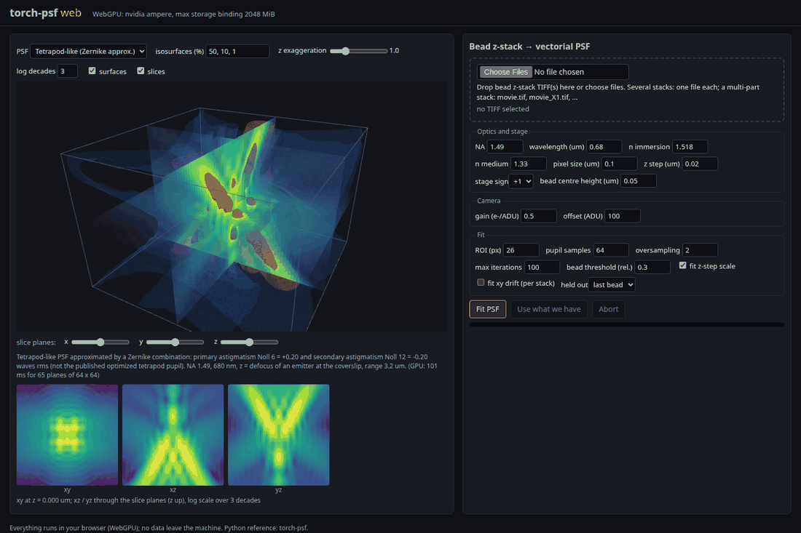

# torch-psf web (v1)

A static web page that fits a vectorial PSF to a bead z-stack, entirely in the browser: TypeScript + WebGPU (WGSL
compute shaders), no server and no installation. The Python implementation of the same physics (torch-psf; until it exists, SIMCODE's
`VectorialPSF` code) is the reference; the web results are tested against it (see "Validation").



On opening, the page shows a default PSF computed on the GPU in a slowly rotating 3D view (it stops on the first mouse
interaction). Presets: tetrapod-like, astigmatic, in-focus 2D, and the loaded file's fit result.
The tetrapod-like preset is a Zernike approximation (primary astigmatism Noll 6 = +0.20 and secondary astigmatism Noll 12 =
-0.20 waves rms), not the published optimized tetrapod pupil.

## Run locally

```
cd web
npm ci            # exact versions from package-lock.json
npm run dev       # http://localhost:5173 (needs a WebGPU browser, see below)
npm run build     # static site in web/dist/ (BASE=/torch-psf/ npm run build for the GitHub Pages path)
npm run preview   # serve dist/
```

Node 18+ for the build. The test runner is Python (Playwright with Chromium), because npm Playwright needs Node 20:

```
pip install playwright && python -m playwright install chromium
python test/run_tests.py                 # starts vite, runs test.html headless, prints PASS / FAIL per test
python test/run_tests.py --only fit      # a subset
python test/run_tests.py --screenshot    # also drives the app with the generated tetrapod stack: docs/*.png, exports checked
```

The test references are generated, not stored: `run_tests.py` runs `../tests/make_web_reference.py` into
`test/.cache/` (ignored by git) when that folder is missing or the generator has changed (about 2 min on a GPU; needs
torch, tifffile, imagecodecs and SIMCODE's `simcode/psf/vectorial.py` / `conv_spline.py` code, found via `SIMCODE_DIR` or
`~/simcode2`). All test PSFs are generated from known parameters (the astigmatic and tetrapod-like presets); no fitted
calibration is used. The only tracked data file is a one-bead real crop, `../tests/data/web/real_bead.tif` (30 x 30 px x
151 planes, 0.3 MB, from PSF_calib zstack2-1).

## Using it

1. Drop one or more bead z-stack TIFFs (or choose files). Several stacks: one file each. A stack split over several files
   (`stack.tif`, `stack_X1.tif`, ... or `_1`, `_2`, ...) is joined in part order.
2. Fill in the form: NA, wavelength, n immersion / n medium, pixel size, z step, stage sign (direction of the stage
   steps), bead centre height above the coverslip, camera gain / offset (ADU -> photons), ROI size, pupil sampling /
   oversampling, whether to fit a z-step scale and per-stack xy drift, and which beads are held out.
3. "Fit PSF". The progress bar shows the stage (reading, fit iteration with NLL per pixel and the LM damping, held-out
   refit), elapsed time and an estimate of the time left. "Enough frames" (while reading) / "Stop and keep current
   estimate" (while fitting) continue with what is there; "Abort" discards.
4. Results: 3D view of the fitted PSF, the Zernike coefficients, NLL per pixel of the fitted beads and of the held-out
   bead (refitted with the PSF frozen), and data / model / residual images (xy at a plane, xz) per bead.
5. Exports: `psf.json` (torch-psf schema: `format`, `optics`, `zernike_noll`, `zernike_waves`, `focus_um`, ...; also
   SIMCODE's calib keys `pixelsize_um`, `wavelength_um`, `NA`, `n_imm`, `n_med`; `provenance` records the fit, including
   `partial`), `psf_spline.npz` (knots of the convolutional Catmull-Rom spline, S = 2, hz = 0.04 um, the same grid as
   SIMCODE's `ConvSplinePSF`: `knots [nz, nv, nu]`, `z0`, `hz`, `S`, `u0`, `roisize`, `xmax`, `focus_um`, Zernikes) and
   `psf_model_zstack.tif` (float32 normalized model PSF at the stack's planes, ImageJ stack).


### The fit

Per bead: x, y and a focus offset; per image (bead x plane): intensity and background; global: Zernike Noll 5-21 (waves
rms), optionally a z-step scale and per-stack xy drift (polynomial degree 1-4 in the plane index). The focus of plane j
is `sign * dz * scale * (j - (nz - 1) / 2) - zoff + z_e`, with the bead a point emitter at height `z_e`. Poisson
likelihood, Levenberg-Marquardt: the GPU computes the PSF, its derivatives (x, y, focus, 17 Zernikes) and the per-image
normal equations; the CPU eliminates the per-image and per-bead blocks (Schur complement) and solves the global system.
Beads are the isolated maxima of the mean projection over z (R x R neighbourhood, above median + 0.3 x range; the mean
projection is peaked at the bead centre also for wide PSFs such as the tetrapod, whose max projection has one maximum
per lobe). Not modelled (unlike SIMCODE's `fit_beads`): finite bead size, bleaching / per-slice intensity terms
(here every plane has its own intensity), NA / n_med fits.

## Supported

- Browsers: WebGPU is required (Chrome / Edge 113+ on Windows, macOS, ChromeOS; on Linux Chrome with
  `--enable-unsafe-webgpu --enable-features=Vulkan`; Safari 26+; Firefox 141+ on Windows). Without WebGPU the page says
  so; there is no CPU fallback (use the Python package).
- TIFF: classic and BigTIFF, little and big endian; uint8 / uint16 / uint32 / int16 / int32 / float32, one sample per
  pixel; strips or tiles; uncompressed, Deflate / Adobe Deflate, LZW, PackBits; horizontal predictor; ImageJ,
  OME-TIFF (single channel) and tifffile stacks. Files are read lazily by byte ranges (`File.slice`); for uncompressed
  frames with a constant stride the IFD chain is extrapolated from the first IFDs and verified on the last one.
  Not supported: JPEG / JPEG2000 / LZMA / Zstd / WebP compression, RGB / multi-sample data, floating-point predictor,
  dcimg (clear error messages).
- All computation is float32 on the GPU, float64 for the small CPU solves.

## Layout

```
src/gpu/        device.ts (adapter / limits), ops.ts (VecEngine: chunked dispatch), kernels/*.wgsl
src/psf/        vectorial.ts (pupil precompute, Zernikes, derivative directions), spline.ts (knot export)
src/fit/        beads.ts (bead finding, LM with Schur elimination), linalg.ts
src/io/         tiff.ts (lazy reader), npy.ts (npy / npz read + write), tifwrite.ts, psfjson.ts
src/ui/         app.ts, view3d.ts (three.js scene: isosurfaces + slice planes), isosurface.ts (marching tetrahedra),
                colormap.ts, protocol.ts (worker messages), style.css
src/worker.ts   compute worker (TIFF reading, all GPU work, exports)
src/core/       task.ts (stop token, progress, ETA)
test/           tests.ts + test_*.ts (browser tests), run_tests.py (headless runner), screenshot.py
```

Kernels: `phase` (per-image pupil field with the aberration, position and focus phase), `dft1` / `dft2` (the two matrix
DFTs as tiled complex GEMMs for the value and all derivative directions; the second one directly forms the intensity
and its derivatives 2/3 sum Re(conj(E0) dE)), `bin` (pixel integration), `normal_eq` and `nll` (Poisson). GPU work is
submitted in bounded chunks of images; the next chunk is submitted after `onSubmittedWorkDone`, and the stop token is
checked in between.

## Validation (python test/run_tests.py, RTX 3090 via Vulkan, headless Chromium)

| test | result | criterion (DESIGN.md) |
|---|---|---|
| PSF images vs SIMCODE's `VectorialPSF` code, 4 optics sets (tetrapod-like, astigmatic, 2 random Zernike sets; NA 1.2-1.49, os 1-3, npupil 32-64) | max rel. error <= 2e-6 | 1e-4 |
| Jacobian (x, y, focus, z_e, 17 Zernikes) vs the same code (forward-mode AD) | max rel. error <= 3e-6 | 1e-3 |
| TIFF reader, 17 tifffile cases + multi-part | identical values | |
| bead fit, generated astigmatic stack (3 beads, z-step scale fitted) vs the Python fit of the same model | Zernikes 0.0000 w rms, focus 0.00 nm, PSF L2 2e-6, held-out NLL 1.5e-6 rel.; vs truth 0.0002 w rms | 0.005 w, 5 nm, 1e-2, 1e-3 |
| bead fit, generated tetrapod-like stack (3 beads, ROI 40, 3 um z range) | Zernikes 0.0000 w rms, focus 0.00 nm, PSF L2 3e-7, held-out NLL 1.2e-6 rel.; vs truth 0.0001 w rms | same |
| bead fit, one-bead real crop vs the Python fit (no held-out bead; z-step scale fixed) | Zernikes 0.0000 w rms, focus 0.05 nm, PSF L2 7e-5, NLL 4e-7 rel. | same |
| spline knots vs SIMCODE's `ConvSplinePSF` code | max rel. error 2e-6 | |

With a single real bead and a free z-step scale the fit has several optima (the web LM and the Python L-BFGS ended in
different ones), so that test keeps the z step fixed.

Timing on this server (RTX 3090): one LM iteration for 1200 images of 26 x 26 px (12 beads x 100 planes), npupil 64:
about 100-120 ms (normal equations) + 15 ms per trial NLL pass; the tetrapod test stack (3 beads x 61 planes of 40 x 40)
fits in about 1.5 s.

## GitHub Pages

`.github/workflows/pages.yml` builds `web/` with `BASE=/torch-psf/` and deploys `web/dist` to
https://jcnossen.github.io/torch-psf/. Pages must be enabled once in the repository settings (Settings -> Pages ->
Source: GitHub Actions).
