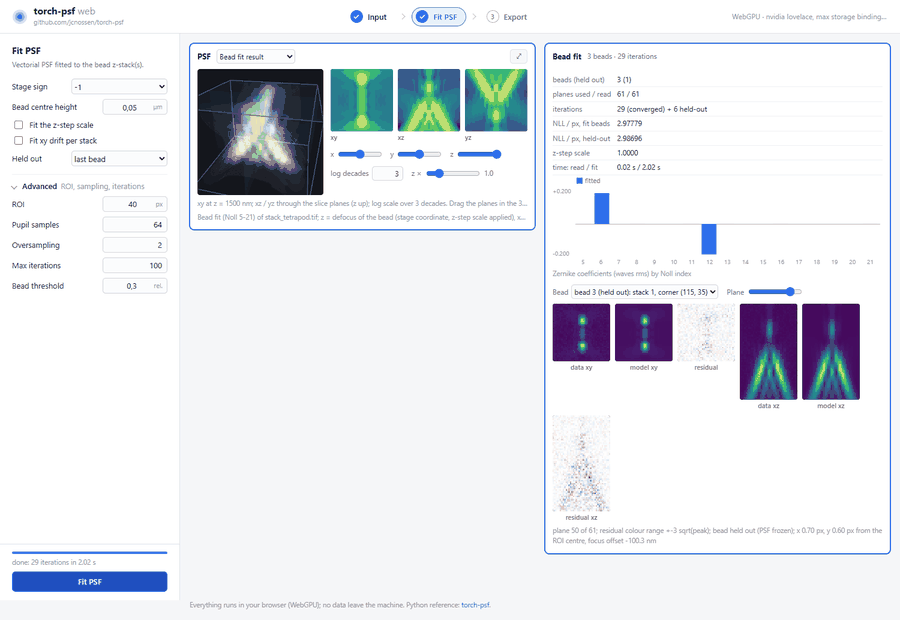

# torch-psf web (v1)

A static web page that fits a vectorial PSF to a bead z-stack, and detects and localizes the spots of an SMLM movie,
entirely in the browser: TypeScript + WebGPU (WGSL compute shaders), no server and no installation. The Python package
torch-psf (`torch_psf`, in this repository) is the reference: every step is a port of a torch_psf function, and the
browser tests compare the web results with torch_psf outputs (see "Validation").


The 3D view shows the PSF computed on the GPU, slowly rotating (it stops on the first mouse interaction): ten nested white isosurfaces (60 % to 2 % of the peak, additive, so the inner ones add up to a soft
glow) and three faint slice planes. Presets: tetrapod-like, astigmatic, in-focus 2D, and the loaded file's fit result.
The slice planes (log scale, bilinear, interpolated between z planes) move with the sliders or by dragging a plane
(hover highlights it) along its normal.
The tetrapod-like preset is a Zernike approximation (primary astigmatism Noll 6 = +0.20 and secondary astigmatism Noll 12 =
-0.20 waves rms), not the published optimized tetrapod pupil.

## Run locally

```
cd web
npm ci            # exact versions from package-lock.json
npm run dev       # http://localhost:5173 (needs a WebGPU browser, see below)
npm run build     # static site in web/dist/ (BASE=/torch-psf/ npm run build for the GitHub Pages path)
npm run preview   # serve dist/
```

Node 18+ for the build. The test runner is Python (Playwright with Chromium), because npm Playwright needs Node 20:

```
pip install playwright && python -m playwright install chromium
python test/run_tests.py                 # starts vite, runs test.html headless, prints PASS / FAIL per test
python test/run_tests.py --only fit      # a subset
python test/run_tests.py --screenshot    # also drives the app with the generated tetrapod stack: docs/*.png, exports checked
```

The test references are generated, not stored: `run_tests.py` runs `../tests/make_web_reference.py` into
`test/.cache/` (ignored by git) when that folder is missing or the generator has changed (about 2 min on a GPU; needs
torch, tifffile, imagecodecs and `torch_psf` from this repository), and `../tests/make_web_smlm_reference.py` into
`test/.cache/smlm/` (a seeded simulated movie and the torch_psf detections / localizations of it). All test PSFs are generated from known parameters (the astigmatic and tetrapod-like presets); no fitted
calibration is used. The only tracked data file is a one-bead real crop of public data,
`../tests/data/web/epfl_npc_bead.tif` (30 x 30 px x 41 planes, 81 kB, from the bead stack of the EPFL SMLM challenge
2016 real 3D data set NPC-A647-3D; source, citation and the assumed acquisition settings in `epfl_npc_bead.json`).

## Using it

The page is laid out as a workflow. The left sidebar has one "Run all" button at the top (with the progress bar and
Stop early / Abort), then tabs for the stages (SMLM movie: Input, Detect spots, Fit PSF, Localize, Export; bead
z-stack: Input, Fit PSF, Export; localization file: Input, Export). A tab shows the settings of that stage and
outlines the views it feeds; finished stages get a check. "Run all" runs every stage in one go (for a movie: spot
detection, the PSF fit, localization) and opens the tab of the stage that is running. The Input tab holds the data (SMLM movie, bead
z-stack or localization file), the optics (pixel size and wavelength in nm, NA, refractive indices) and the camera
(sCMOS / EMCCD, gain, offset, read noise); less common settings are under each step's "Advanced" fold.

When a TIFF movie is opened, the camera gain and offset are measured from it (torch_psf `photon_transfer`, ported
in `src/smlm/camera.ts`: blocks of frames spread over the movie, per-pixel temporal mean and frame-difference
variance of background samples away from detected spots, a line through the binned medians; the only deviation is a
shorter block when block x H x W would exceed the 128 MiB storage-buffer limit, e.g. 128 frames for 512 x 512).
Choosing EMCCD sets the excess noise F^2 = 2 and rescales the gain. The mean-variance line cannot separate the
offset from the read noise (its intercept is readnoise^2 - slope x offset; Heintzmann et al., arXiv:1611.05654): by
default the offset is estimated and absorbs the read-noise variance, and the read noise is entered by hand; with
"Offset known" (camera specification or dark frames) the read noise is estimated from the intercept instead
(torch_psf photon_transfer(offset_adu=...)). The demo
movie has a uniform background, which gives the line nothing to fit, so its (known) camera is not re-measured.

The views are cards: the movie and the reconstruction side by side with one shared zoom and pan ("Linked"; wheel to
zoom, drag to pan, double-click to fit), a compact PSF view (3D view plus xy / xz / yz sections; the expand button
makes it larger) and the fit summary (Zernike bars and status checks; "Report" shows the full table). Small
numbers next to the controls refer to the reference list at the bottom of the page (the papers behind each method:
vectorial PSF and Zernikes, in-situ PSF estimation, maximum-likelihood localization and CRLB, sCMOS read noise, EMCCD excess noise, photon transfer, the optimizers and the file formats).

### SMLM movie (default): in-situ PSF estimation

On opening, the page simulates a small demo movie in the browser (600 frames of 128 x 128 px, astigmatic PSF with
Noll 5 / 6 / 11 = 0.02 / 0.10 / 0.03 waves, blinking sites on curved filaments, camera with read noise; the model of
torch_psf.simulate.simulate_reference_movie with filament_sites) and plays it in the Movie panel (autoplay, frame slider). Drop
your own movie (TIFF, streamed) to replace it.

Open or drop all parts of a multipart movie together. Large Micro-Manager TIFFs use their embedded frame index
to open without scanning every frame header; pixels are read on demand in windows of at most 8 MiB. Other TIFFs
show a frame counter while their directories are indexed. The Input stage shows opening progress, errors and
Cancel opening; the preview and frame slider remain usable without loading the full movie. Localization details
include separate reading, detection and GPU fitting times.

The PSF fit (Fit PSF stage of "Run all") runs torch_psf's InSituEstimator, ported step by step: spot detection and ROIs, a 16 px checkerboard
split into spots for the fit and held-out spots, the in-situ fit of the vectorial PSF by the knot route
(fit_zernike_knots: knots of the spline from the vectorial model, Levenberg-Marquardt localization on the spline, the
NLL gradient on the knots, one vector-Jacobian product to the Zernikes, Adam), the held-out NLL of the start and the
fitted PSF, the z scale relative to the start. As torch_psf's InSituEstimator, spots the single-emitter model does
not explain (overlapping emitters; Poisson deviance per pixel above 1 + 3 sqrt(2 / P^2) after the first pass) are
rejected and the fit is repeated from the first-pass result (3/4 of the iterations). Optional "spline refinement"
(Fit PSF step; InSituEstimator(refine=True), torch_psf.estimation.fit_free_knots): free spline knots regularised towards the
fitted vectorial spline and smooth, alternating localization and a torch.optim.LBFGS (strong Wolfe) step on the knots,
12 times; kept only if it improves the held-out NLL (then the movie is localized with it and the 3D view shows the
knots), with its z scale relative to the vectorial fit and the warning that free knots can warp z. On the demo, which
is simulated from the vectorial model itself, it is (correctly) not kept. The Zernike bars update during the fit (start, fitted and, for the
demo, the truth). The fitted PSF is then shown in the 3D view (z = emitter height at the focal plane), the movie is
localized with it and the Reconstruction panel shows them as a point cloud (colour = z; csv export): rendered at
screen resolution for the current view, each localization a Gaussian sized in nm (its CRLB, capped, or one fixed
blur) integrated over the screen pixel, additive; pan, zoom and orbit (rotate about z, tilt to a side view, z
exaggeration); a global display maximum so the brightness does not jump; above a point cap while dragging, a fixed
hash-ranked subset weighted to keep the brightness (the principles of webSMLM's point-cloud renderer and its
tilt / rotate view). The fit starts from
a generic astigmatic PSF (Noll 6 = 0.08) unless another start is chosen in the Fit PSF step (the PSF in the 3D view, the last
estimate, or a `psf.zip`). On the demo it recovers the truth to about 0.001 waves rms in about a minute on a laptop iGPU. The Localize step localizes again (with the last estimate, or the start PSF if there is none) without estimating the PSF.
"Fit report (PDF)" in the Export step writes `fit_report.pdf` (see "Fit report" below); "PSF (psf.zip)" writes the shared PSF file (see
"psf.zip" below).

### Bead z-stack

1. Drop one or more bead z-stack TIFFs (or choose files). Several stacks: one file each. A stack split over several files
   (`stack.tif`, `stack_X1.tif`, ... or `_1`, `_2`, ...) is joined in part order.
2. Fill in the form: NA, wavelength, n immersion / n medium, pixel size, z step, stage sign (direction of the stage
   steps), bead centre height above the coverslip, camera gain / offset (ADU -> photons), ROI size, pupil sampling /
   oversampling, whether to fit a z-step scale and per-stack xy drift, and which beads are held out.
3. "Fit PSF". The progress bar shows the stage (reading, fit iteration with NLL per pixel and the LM damping, held-out
   refit), elapsed time and an estimate of the time left. "Enough frames" (while reading) / "Stop and keep current
   estimate" (while fitting) continue with what is there; "Abort" discards.
4. Results: 3D view of the fitted PSF, the Zernike coefficients, NLL per pixel of the fitted beads and of the held-out
   bead (refitted with the PSF frozen), and data / model / residual images (xy at a plane, xz) per bead.
5. Exports: `psf.zip` (below), `psf_model_zstack.tif` (float32 normalized model PSF at the stack's planes, ImageJ
   stack) and `fit_report.pdf`.

### psf.zip

The shared PSF file of torch-psf (format `torch-psf` 0.2.0, `../docs/PSF_FORMAT.md`), one button per fit: `psf.json`
with one channel (the fitted vectorial model, or with "spline channel" a spline whose `source` is the vectorial model:
bead fit: the model tabulated on the export spline grid; in-situ: the refined free knots when they were kept, else the
model tabulated on the fit's knot grid), the camera gain / offset, provenance and the report summary; the knots as
`ch0/knots.npy`; `zstack.tif` (ImageJ hyperstack ZCYX, float32, spacing / unit / resolution / Info as torch_psf writes
them; default 25 planes at 1 camera px, options "planes" and "sampling 1 / k px"); `preview.png`; `fit_report.pdf`
(without a creation date). Deflated with `CompressionStream('deflate-raw')` (PNG stored), fixed member times: the same
fit gives the same bytes. Bead fit: z = emitter height at the export focus ("imaging focus"), z range = the export
spline z range, ROI = the fit ROI; in-situ: the acquisition focal plane and emitter z range. `torch_psf.io.load` /
`PSFZip.read` read it; the app reads `psf.zip` (channel 0's vectorial model or the `source` of a spline channel; only
the arrays psf.json references are parsed, dtypes the npy reader does not support are skipped) as the start PSF of the
in-situ fit. Code: `src/io/zip.ts`, `src/io/imagejtif.ts`, `src/io/psfzip.ts`, `src/psf/zstack.ts`, `src/psf/makezip.ts`,
`src/report/preview.ts`, `src/ui/exportzip.ts`.

### Fit report (PDF)

`fit_report.pdf` is written in the browser by a small dependency-free PDF writer (`src/io/pdf.ts`: A4 pages, the
standard Helvetica / Symbol fonts with WinAnsi encoding, nothing embedded; vector lines, rectangles and text; RGB images
Flate-compressed with `CompressionStream('deflate')`, uncompressed without it) and a plotting layer (`src/report/`).
Sections, each left out without data: settings and results tables, spot / bead counts (accepted, rejected, held out),
loss convergence (in situ: per pass, relative to the pass minimum), Zernike coefficients (bars with error bars when
given, start and demo truth), histograms (in situ: photons, background, z, CRLB of the movie's localizations), pupil
amplitude and aberration phase, PSF xy slices and the xz section (log scale), the ROI quality range (one page: a
histogram of a per-ROI score q with the acceptance cutoff, then data / model / difference of the 3 best ROIs, the 3
last accepted just below the cutoff and the 3 first rejected just above; in situ: q = first-pass deviance per pixel and
the overlap rejection threshold, only the ~9 shown ROIs leave the worker; beads: q = chi2 per pixel of a bead, no
rejection, a reference line median + 3 x 1.4826 MAD), example ROIs (beads: data / model / difference at the middle
plane, held-out beads first) and Zernike-over-field maps. `makeFitReport(data: FitReportData)` in
`src/report/fitreport.ts` is the entry point; the report code is loaded on demand (a separate 39 kB chunk).



### The fit

Per bead: x, y and a focus offset; per image (bead x plane): intensity and background; global: Zernike Noll 5-21 (waves
rms), optionally a z-step scale and per-stack xy drift (polynomial degree 1-4 in the plane index). The focus of plane j
is `sign * dz * scale * (j - (nz - 1) / 2) - zoff + z_e`, with the bead a point emitter at height `z_e`. Poisson
likelihood, Levenberg-Marquardt: the GPU computes the PSF, its derivatives (x, y, focus, 17 Zernikes) and the per-image
normal equations; the CPU eliminates the per-image and per-bead blocks (Schur complement) and solves the global system.
Beads are the isolated maxima of the mean projection over z (R x R neighbourhood, above median + 0.3 x range; the mean
projection is peaked at the bead centre also for wide PSFs such as the tetrapod, whose max projection has one maximum
per lobe). Not modelled (unlike torch_psf's `fit_beads`): finite bead size, bleaching / per-slice intensity terms
(here every plane has its own intensity), NA / n_med fits.

## Supported

- Browsers: WebGPU is required (Chrome / Edge 113+ on Windows, macOS, ChromeOS; on Linux Chrome with
  `--enable-unsafe-webgpu --enable-features=Vulkan`; Safari 26+; Firefox 141+ on Windows). Without WebGPU the page says
  so; there is no CPU fallback (use the Python package).
- TIFF: classic and BigTIFF, little and big endian; uint8 / uint16 / uint32 / int16 / int32 / float32, one sample per
  pixel; strips or tiles; uncompressed, Deflate / Adobe Deflate, LZW, PackBits; horizontal predictor; ImageJ,
  OME-TIFF (single channel) and tifffile stacks. Files are read lazily by byte ranges (`File.slice`); for uncompressed
  frames with a constant stride the IFD chain is extrapolated from the first IFDs and verified on the last one.
  Not supported: JPEG / JPEG2000 / LZMA / Zstd / WebP compression, RGB / multi-sample data, floating-point predictor,
  dcimg (clear error messages).
- All computation is float32 on the GPU, float64 for the small CPU solves.

## Layout

```
src/gpu/        device.ts (adapter / limits), ops.ts (VecEngine: chunked dispatch), kernels/*.wgsl
src/psf/        vectorial.ts (pupil precompute, Zernikes, derivative directions), spline.ts (spline knots of a vectorial PSF), zstack.ts (z-stack
                render, spline evaluation), makezip.ts (psf.zip of a fit)
src/fit/        beads.ts (bead finding, LM with Schur elimination), linalg.ts
src/io/         tiff.ts (lazy reader), npy.ts (npy write, npy / npz read), zip.ts, tifwrite.ts, imagejtif.ts (hyperstack),
                psfzip.ts (psf.zip json / write / read), pdf.ts + pdffonts.ts (PDF writer)
src/report/     plot.ts (axes, line / bar / histogram, images with colour bars, tables), fitreport.ts (makeFitReport),
                fromapp.ts (report data from the in-situ / bead results)
src/ui/         app.ts, view3d.ts (three.js scene: isosurfaces + slice planes), isosurface.ts (marching tetrahedra),
                colormap.ts, protocol.ts (worker messages), style.css
src/worker.ts   compute worker (TIFF reading, all GPU work, exports)
src/core/       task.ts (stop token, progress, ETA)
test/           tests.ts + test_*.ts (browser tests), run_tests.py (headless runner), screenshot.py
```

Kernels: `phase` (per-image pupil field with the aberration, position and focus phase), `dft1` / `dft2` (the two matrix
DFTs as tiled complex GEMMs for the value and all derivative directions; the second one directly forms the intensity
and its derivatives 2/3 sum Re(conj(E0) dE)), `bin` (pixel integration), `normal_eq` and `nll` (Poisson). GPU work is
submitted in bounded chunks of images; the next chunk is submitted after `onSubmittedWorkDone`, and the stop token is
checked in between.

## Validation (python test/run_tests.py, RTX 3090 via Vulkan, headless Chromium)

| test | result | criterion (DESIGN.md) |
|---|---|---|
| PSF images vs torch_psf's `VectorialPSF`, 4 optics sets (tetrapod-like, astigmatic, 2 random Zernike sets; NA 1.2-1.49, os 1-3, npupil 32-64) | max rel. error <= 2e-6 | 1e-4 |
| Jacobian (x, y, focus, z_e, 17 Zernikes) vs the same code (forward-mode AD) | max rel. error <= 3e-6 | 1e-3 |
| TIFF reader, 17 tifffile cases + multi-part | identical values | |
| bead fit, generated astigmatic stack (3 beads, z-step scale fitted) vs the Python fit of the same model | Zernikes 0.0000 w rms, focus 0.00 nm, PSF L2 2e-6, held-out NLL 1.5e-6 rel.; vs truth 0.0002 w rms | 0.005 w, 5 nm, 1e-2, 1e-3 |
| bead fit, generated tetrapod-like stack (3 beads, ROI 40, 3 um z range) | Zernikes 0.0000 w rms, focus 0.00 nm, PSF L2 3e-7, held-out NLL 1.2e-6 rel.; vs truth 0.0001 w rms | same |
| bead fit, one-bead real crop vs the Python fit (no held-out bead; z-step scale fixed) | Zernikes 0.0000 w rms, focus 0.05 nm, PSF L2 7e-5, NLL 4e-7 rel. | same |
| spline knots vs torch_psf's `CubicSplinePSF` (knots_from_vectorial) | max rel. error 2e-6 | |
| psf.zip written by torch_psf (vectorial with camera maps and extras; spline with source) read here; web render vs its zstack.tif | Zernikes identical; render max rel. 1.4e-6 (vectorial, 1 / 2 px) / 9e-8 (spline); bool / unicode camera extras skipped | 1e-4 / 1e-5 |
| psf.zip written here (vectorial, spline) read by torch_psf (`tests/test_web_psfzip.py`, after the web tests) | Zernikes / optics identical; torch_psf render vs the web zstack.tif 7e-7 / 1e-7; zstack.tif tags identical to tifffile's; knots vs knots_from_vectorial 9e-7; byte-reproducible | 1e-4 / 1e-5 |
| PDF writer and fit report (synthetic data, all sections; empty and partial reports) | header, xref offsets, stream lengths, page count, Flate streams inflate to the image sizes; the report is saved to `test/out/fit_report_test.pdf` | |
| ROI quality range (synthetic bands, bead chi2 with reference line, in-situ estimate of a small demo movie) | bands around the cutoff, rejected count = n_rejected, the deviance of the shown data / model reproduces q (max rel. 4e-6); `test/out/quality_range_insitu.pdf`, `quality_range_beads.pdf` | 2e-2 |
| SMLM movie: spot detection vs torch_psf `extract_spots` / `detect_spots` (seeded simulated movie, 300 frames, chunks of 100) | identical spots and order (718 / 718), noise rel. 2e-6 | |
| SMLM movie: spline localization vs torch_psf `fit.localize` / `crlb` (same knots, 600 spots) | xy 99 % 4e-3 px, z 99 % 1e-3 um, CRLB 1e-3 rel. (float32 vs float64 solves) | 1e-2 px, 3e-3 um |
| SMLM movie: whole pipeline (ADU, detection, knots, localization) vs the torch_psf localization table | same spots and frames; xy 99 % 4e-3 px | 1e-2 px |
| in situ: knot gradient and Zernike gradient (VJP) vs torch_psf knot_gradient / vjp_vectorial (1850 ROIs) | rel. 4e-7 / 2e-6, NLL 1e-7 | 1e-3 |
| in situ: fit_zernike_knots, 40 iterations on the torch_psf training ROIs | Zernikes 2e-6 w rms from torch_psf | 2e-3 w |
| in situ: whole InSituEstimator (movie, spots, split, fit, overlap rejection, second pass, held-out, z scale) | same 4346 spots and split, same 92 rejected; Zernikes 3e-6 w rms; held-out NLL change and z scale identical to 4 digits | 2e-3 |
| in situ: spot deviance per pixel vs estimation.spot_deviance (1850 spots) | max abs. diff 2e-5; no spot on the other side of the threshold | 1e-3 |
| in situ: fit_free_knots (3 outer L-BFGS iterations from the vectorial spline, 1850 ROIs) | loss per outer within 2 of 3e7; knots 2.5e-4 of the peak from torch_psf (the refinement moves them 7e-2) | 0.1 x the change |
| in situ: whole InSituEstimator(refine=True) | same decision (kept); held-out NLL/px refined - vectorial -3.47e-4 vs -3.52e-4; z scale vs vectorial 1.0003 (same) | 1e-4, 0.01 |
| camera: photon_transfer (1200 frames, varying background; defaults, given offset, EMCCD, other keywords) | same detections and pixel counts; gain, offset, slope rel. 1e-7, read noise 5e-7 | 1e-5 |

With a single real bead and a free z-step scale the fit has several optima (the web LM and the Python L-BFGS ended in
different ones), so that test keeps the z step fixed.

Timing on this server (RTX 3090): one LM iteration for 1200 images of 26 x 26 px (12 beads x 100 planes), npupil 64:
about 100-120 ms (normal equations) + 15 ms per trial NLL pass; the tetrapod test stack (3 beads x 61 planes of 40 x 40)
fits in about 1.5 s.

## GitHub Pages

`.github/workflows/pages.yml` builds `web/` with `BASE=/torch-psf/` and deploys `web/dist` to
https://jcnossen.github.io/torch-psf/. Pages must be enabled once in the repository settings (Settings -> Pages ->
Source: GitHub Actions).
